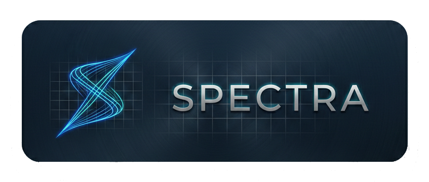
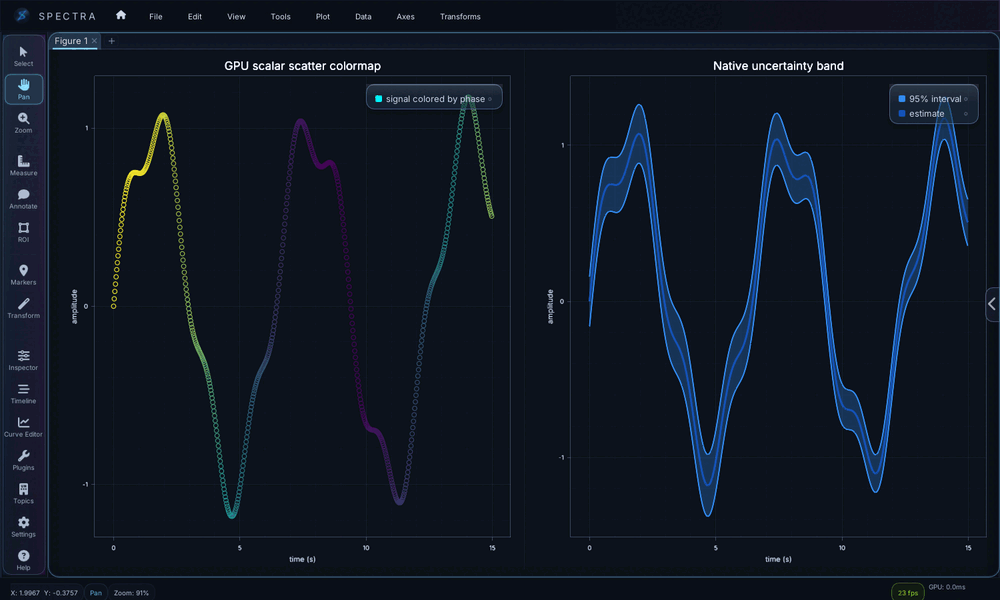
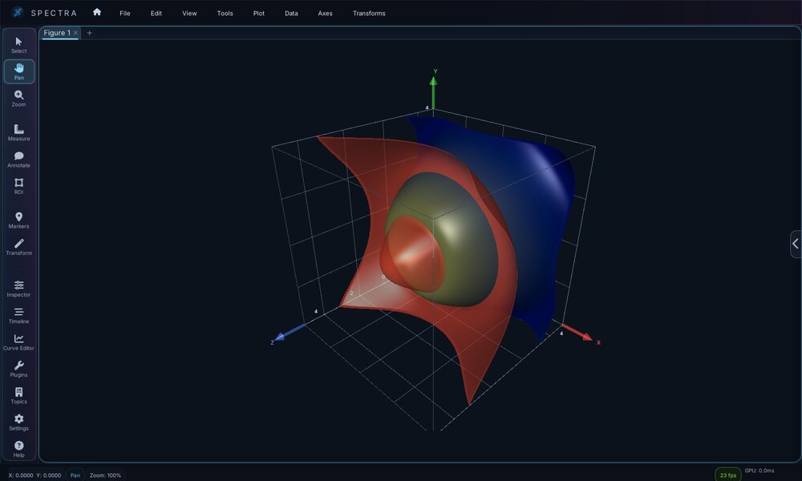
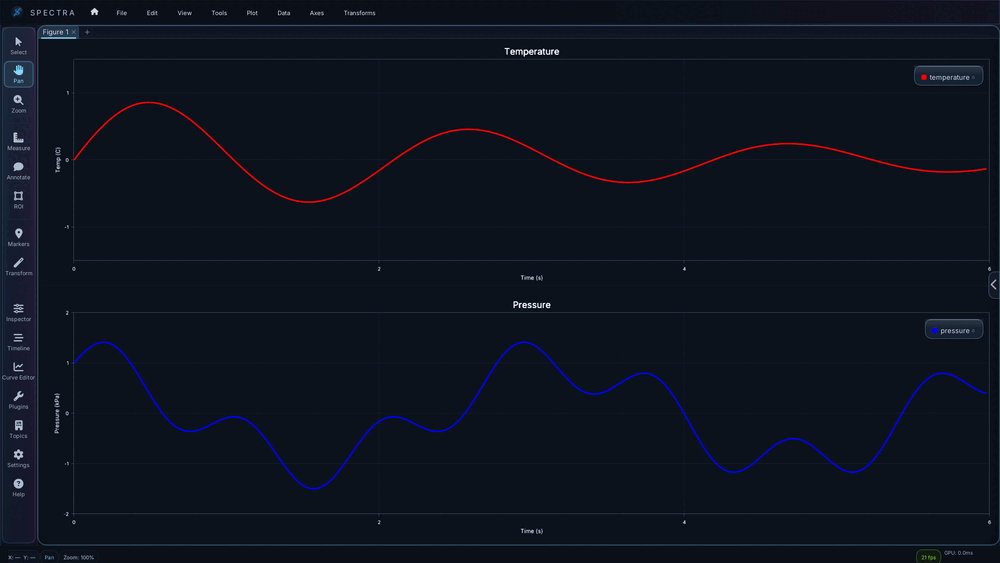
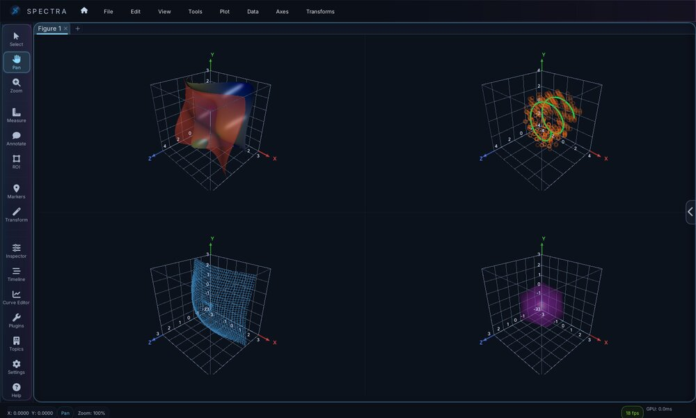

<p align="center">
  
</p>

<h3 align="center">GPU-accelerated scientific plotting for C++20 and Python</h3>

<p align="center">
  <a href="https://github.com/danlil240/Spectra/actions/workflows/ci.yml"></a>
  <a href="https://pypi.org/project/spectra-plot/"></a>
  <a href="https://danlil240.github.io/Spectra/"></a>
  <a href="LICENSE"></a>
</p>

<p align="center">
  <a href="https://danlil240.github.io/Spectra/">Documentation</a> ·
  <a href="https://danlil240.github.io/Spectra/getting-started.html">Getting Started</a> ·
  <a href="examples/README.md">Examples</a> ·
  <a href="https://danlil240.github.io/Spectra/ros2-adapter.html">ROS2 Adapter</a> ·
  <a href="CHANGELOG.md">Changelog</a>
</p>

<table>
  <tr>
    <td width="50%"></td>
    <td width="50%"></td>
  </tr>
  <tr>
    <td width="50%"></td>
    <td width="50%"></td>
  </tr>
</table>

> **Status: 0.x public preview.** Spectra is usable today, but the API may change before 1.0.
> Feedback and bug reports are very welcome.

---

## What is Spectra?

Spectra is a plotting library and desktop app that draws everything on the GPU with Vulkan.
You can call it from C++ or Python, use it for static figures or live data, and embed it in
Qt or ROS2 tools.

- **GPU rendering** — Vulkan 1.2+. Anti-aliased lines, 17 marker shapes, dash patterns and text
  are drawn on the GPU.
- **Real-time** — stream live data at display rate with cheap appends; NumPy arrays are sent
  without per-element copies.
- **2D and 3D in one library** — lines, scatter, statistics, surfaces and meshes with lighting,
  transparency, colormaps and an orbit camera.
- **MATLAB-style one-liners** — `spectra::plot(x, y, "r--o")` scales up to multi-window,
  multi-tab workspaces.
- **C++ and Python** — a native C++20 library, plus a Python package that starts the Spectra
  backend for you.
- **Headless export** — render PNG, SVG, GIF or MP4 without a window, for CI and batch jobs.

## Why Spectra?

There are many good plotting tools. This is how Spectra compares with the ones people ask about
most. The short version: pick Spectra when you want GPU speed, live data and 3D from both C++ and
Python, especially in robotics. Pick something else when you need a mature ecosystem or a
pure-Python install.

| | Spectra | matplotlib | ImPlot | VisPy | pyqtgraph | PlotJuggler |
|---|---|---|---|---|---|---|
| Rendering | GPU (Vulkan) | CPU | GPU (via your ImGui backend) | GPU (OpenGL) | CPU, optional OpenGL | CPU / OpenGL (Qt) |
| Use from | C++20 and Python | Python | C++ (inside Dear ImGui) | Python | Python | Desktop app + plugins |
| Live streaming | Yes | Limited | Yes | Yes | Yes | Yes |
| 3D | Yes (surfaces, meshes, lighting) | Basic (mplot3d) | Separate project (ImPlot3D) | Yes | Yes (OpenGL) | No |
| Ready-made app UI | Yes (inspector, timeline, workspaces) | No | No (you build it) | No | No | Yes |
| ROS2 / PX4 | Built-in adapters (preview) | No | No | No | No | Yes, mature |
| Publication output | PNG, SVG, GIF, MP4 | Excellent (PDF, SVG, PGF, ...) | Screenshots | PNG | PNG, SVG | Limited |
| Maturity and ecosystem | New (0.x) | Decades, huge | Mature | Mature | Mature | Mature in robotics |
| Install | pip wheel or apt, needs a Vulkan driver | Pure pip | Compile into your app | pip + OpenGL | pip + Qt | apt / snap / AppImage |

Where others are clearly better today: **matplotlib** for publication figures, documentation and
third-party packages; **ImPlot** if you already have a Dear ImGui app; **pyqtgraph** for a
pure-Python Qt stack with no GPU driver requirements; **PlotJuggler** for a battle-tested ROS
log viewer.

---

## Quick start

**C++**

```cpp
#include <spectra/easy.hpp>

int main() {
    spectra::plot({0.f, 1.f, 2.f, 3.f, 4.f},
                  {0.f, 1.f, 0.5f, 1.5f, 2.f}, "c-o");
    spectra::title("Hello Spectra");
    spectra::show();
}
```

**Python**

```python
import spectra as sp
sp.plot([0, 1, 4, 9, 16, 25])
sp.show()
```

A slightly bigger Python example with two subplots:

```python
import spectra as sp
import numpy as np

x = np.linspace(0, 10, 500)

sp.subplot(2, 1, 1)
sp.plot(x, np.sin(x), label="sin")
sp.title("Sine")

sp.subplot(2, 1, 2)
sp.plot(x, np.cos(x), label="cos")
sp.title("Cosine")

sp.show()
```

Live streaming, 3D plots, statistical charts and the Session API are covered in the
[Feature Guide](https://danlil240.github.io/Spectra/features.html#python-api).

---

## Install

### Supported platforms

| Platform | Status | Notes |
|---|---|---|
| Linux x86_64 — Ubuntu 22.04 / 24.04 | **Supported** | X11 and Wayland. GCC 13+ or Clang 17+ to build from source. |
| macOS (Apple Silicon, via MoltenVK) | Experimental | Builds and runs in CI; expect rough edges. |
| Windows x64 | Experimental | In-process mode only (no backend daemon). |
| ROS2, PX4/ULog, Qt embed | Preview | Optional adapters, enabled at build time. |
| WebGPU / WebAssembly | Preview | 2D only. |

Every platform needs a working Vulkan 1.2 driver (Mesa, NVIDIA, AMD, Intel, or MoltenVK on
macOS).

### Python

```bash
pip install spectra-plot
```

No compiler or Vulkan SDK needed — only a Vulkan-capable driver.

### APT repository (Ubuntu 22.04 / 24.04)

```bash
# 1. Import the signing key
curl -fsSL https://danlil240.github.io/Spectra/apt/spectra-archive-keyring.asc \
  | sudo gpg --dearmor -o /etc/apt/keyrings/spectra.gpg

# 2. Add the repository (detects your Ubuntu codename)
echo "deb [signed-by=/etc/apt/keyrings/spectra.gpg] https://danlil240.github.io/Spectra/apt $(lsb_release -cs) main" \
  | sudo tee /etc/apt/sources.list.d/spectra.list

# 3. Install
sudo apt update
sudo apt install spectra
```

Each [GitHub release](https://github.com/danlil240/Spectra/releases) also ships `.deb`, `.rpm`,
AppImage, macOS and Windows packages, all GPG-signed.

### Build from source

```bash
sudo apt install build-essential cmake ninja-build git pkg-config \
    libvulkan-dev vulkan-validationlayers mesa-vulkan-drivers \
    glslang-tools \
    libwayland-dev libxrandr-dev libxinerama-dev libxcursor-dev \
    libxi-dev libxkbcommon-dev libgl1-mesa-dev \
    python3 python3-pillow libeigen3-dev

git clone https://github.com/danlil240/Spectra.git
cd Spectra
cmake -B build -G Ninja -DCMAKE_BUILD_TYPE=Release -DSPECTRA_USE_ROS2=OFF
cmake --build build -j$(nproc)
./build/examples/basic_line
```

GLFW, Dear ImGui and FlatBuffers are downloaded automatically by CMake. The full list of
packages and CMake options, including the optional ROS2, PX4, Qt, WebGPU, Eigen and FFmpeg
integrations, is in [`BUILD_ENVIRONMENT.md`](BUILD_ENVIRONMENT.md) and the
[Getting Started guide](https://danlil240.github.io/Spectra/getting-started.html).

To use Spectra from your own CMake project after `cmake --install build`:

```cmake
find_package(spectra REQUIRED)
target_link_libraries(my_app PRIVATE spectra::spectra)
```

---

## Features

| Area | What you get |
|---|---|
| **Core rendering** | Vulkan pipeline, MSAA, GPU text, SDF anti-aliasing, MATLAB-style format strings (`"r--o"`) |
| **3D** | Surface, mesh, scatter and line plots with lighting, transparency, wireframe and colormaps |
| **Easy API** | `plot()`, `scatter()`, `subplot()`, `plot3()`, `surf()` and friends in one header, `spectra/easy.hpp` |
| **Statistics** | Histograms, box plots, violins, bars, uncertainty bands |
| **Animation** | Frame callbacks, timeline editor, keyframe interpolation, camera animator |
| **UI** | Command palette, undo/redo, docking and split views, inspector, configurable shortcuts |
| **Data interaction** | Tooltips, crosshair, markers, linked axes, shared cursor, data transforms, CSV import |
| **Multi-window** | Independent OS windows, tab tear-off, workspaces you can save and reload |
| **Python** | `spectra.plot()` one-liners, NumPy fast path, live streaming, automatic backend launch |
| **Export** | Headless PNG/SVG/GIF/MP4, plugin API, CMake `find_package` |
| **ROS2** (preview) | Topic monitor, live plotter, bag player/recorder, TF tree, node graph, service caller |
| **PX4 / ULog** (preview) | ULog file reader, flight-log plotting, live MAVLink bridge |
| **Qt embed** (preview) | Spectra canvas inside Qt6 widgets (C++), plus PyQt/PySide integration |
| **WebGPU** (preview) | Same 2D code in the browser through Emscripten |

> **Full breakdown →** [Feature Guide](https://danlil240.github.io/Spectra/features.html)

---

## ROS2 adapter (preview)

One native app for live plotting, bag review and 3D context.

```bash
source /opt/ros/humble/setup.bash
cmake -S . -B build -G Ninja -DSPECTRA_USE_ROS2=ON -DSPECTRA_ROS2_BAG=ON
cmake --build build --target spectra-ros -j$(nproc)

# Terminal 1 — synthetic publisher
ros2 topic pub /cmd_vel geometry_msgs/msg/Twist "{ linear: { x: 0.5 } }" --rate 10

# Terminal 2 — plot it
./build/spectra-ros --topics /cmd_vel:linear.x
```

Ready-made session presets live in [`sessions/presets/`](sessions/presets/):

```bash
./build/spectra-ros --session sessions/presets/tuning.spectra-ros-session   # IMU / PID tuning
```

> **Docs →** [ROS2 Adapter](https://danlil240.github.io/Spectra/ros2-adapter.html) ·
> [Tool comparison](https://danlil240.github.io/Spectra/ros2-comparison.html) ·
> [PX4 Adapter](https://danlil240.github.io/Spectra/px4-adapter.html) ·
> [Qt Embedding](https://danlil240.github.io/Spectra/qt-embed.html)

---

## Live topics

Any process can publish named data streams ("topics") to Spectra from C++ or Python, before or
after the UI is open; you then drag a topic onto an axes to plot it live. See the
[Topics guide](docs/topics.md), including a Docker publisher-first workflow.

---

## WebGPU / WebAssembly (preview)

A WebGPU backend lets the same 2D C++ code run in the browser through Emscripten (WGSL shaders;
line, scatter, grid, text and statistical series). It is in-process only, and 3D is not ported
yet.

```bash
source /path/to/emsdk/emsdk_env.sh
emcmake cmake -B build-wasm -DSPECTRA_USE_WEBGPU=ON -DCMAKE_BUILD_TYPE=Release
cmake --build build-wasm --target webgpu_demo
# Serve build-wasm/examples/ over HTTP and open webgpu_demo.html in Chrome/Edge 113+
```

> **Docs →** [WebGPU backend](https://danlil240.github.io/Spectra/webgpu.html) ·
> [`examples/webgpu_demo.cpp`](examples/webgpu_demo.cpp)

---

## Examples

More than 40 C++ examples and 18 Python scripts cover everything from a basic line plot to lit
3D surfaces, timeline animation, multi-window tabs and headless export.

```bash
./build/examples/basic_line
./build/examples/next_level_scientific
./build/examples/lit_surface_demo
```

> **Index →** [C++ examples](examples/README.md) · [Python examples](python/examples/README.md) ·
> [Examples page](https://danlil240.github.io/Spectra/examples.html)

---

## How it runs: in-process and multi-process

A Spectra program can run in two ways, and both are always compiled in:

- **In-process** (default) — your program owns the window; plot state, UI and the Vulkan
  renderer live in one process.
- **Multi-process** — a `spectra-backend` daemon owns the session and `spectra-window`
  processes draw the windows, connected over a versioned IPC protocol. The Python package and
  topic publishers use this mode, and start the backend automatically when needed.

At runtime an app uses multi-process mode only when it is given a backend socket (the
`SPECTRA_SOCKET` environment variable or `AppConfig::socket_path`); otherwise it runs
in-process. The CMake option `SPECTRA_RUNTIME_MODE` (`multiproc` by default, or `inproc`) only
decides which binaries are built: `multiproc` also builds `spectra-backend` and
`spectra-window`.

> **Details →** [Architecture overview](https://danlil240.github.io/Spectra/architecture.html)

---

## Quality

- **5,000+ unit tests** (Google Test), **50+ golden-image tests** rendered headlessly on
  lavapipe, and benchmark suites.
- CI on Linux (GCC and Clang), macOS (Apple Silicon) and Windows (MSVC), plus AddressSanitizer
  and UndefinedBehaviorSanitizer jobs.
- Release pipeline producing `.deb`, `.rpm`, AppImage, macOS and Windows packages and Python
  wheels, all GPG-signed.

```bash
cmake -B build -G Ninja -DSPECTRA_BUILD_TESTS=ON -DSPECTRA_USE_ROS2=OFF
cmake --build build
ctest --test-dir build -LE gpu --output-on-failure
```

---

## Contributing

Contributions are welcome. Please read [CONTRIBUTING.md](CONTRIBUTING.md) for how to build, run
the tests (including GPU tests on lavapipe), format code and write commit messages, and follow the
[Code of Conduct](CODE_OF_CONDUCT.md). Report security issues privately as described in
[SECURITY.md](SECURITY.md).

If you use Spectra in research, see [CITATION.cff](CITATION.cff).

## License

MIT License. See [LICENSE](LICENSE) for details.
