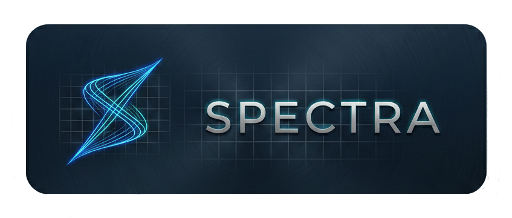
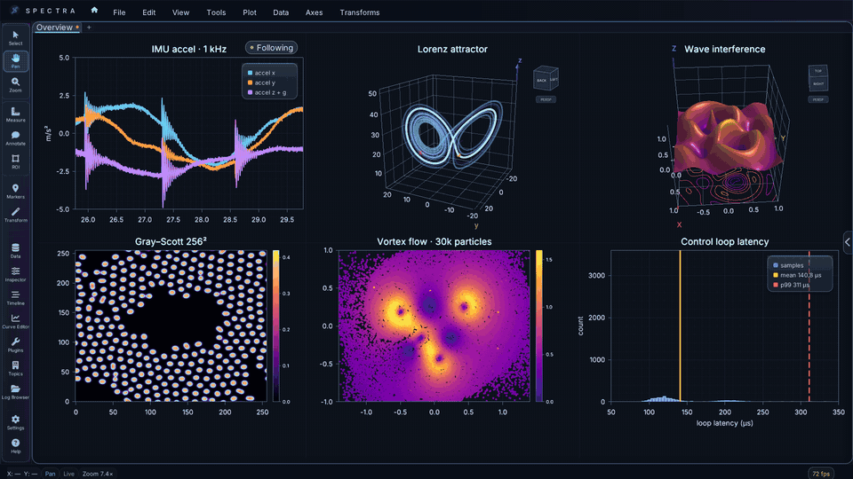
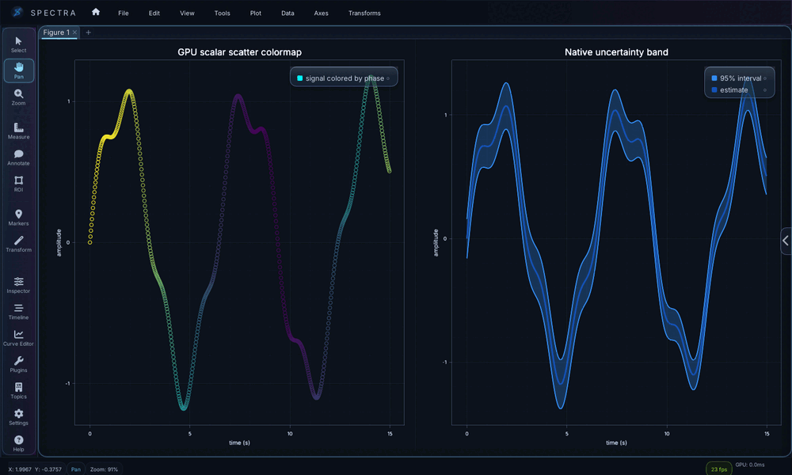
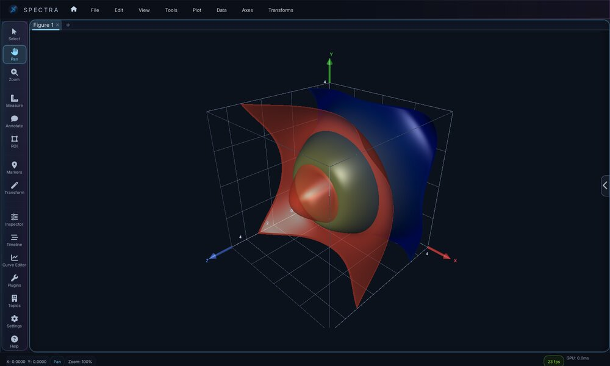
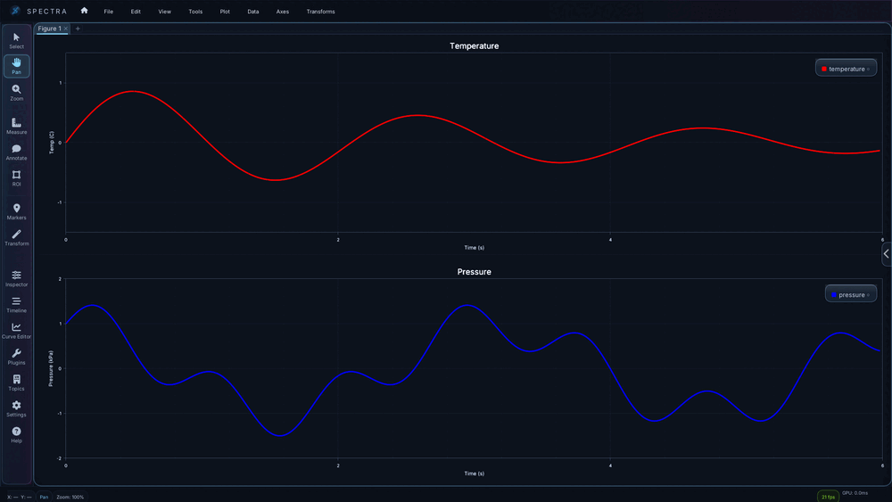
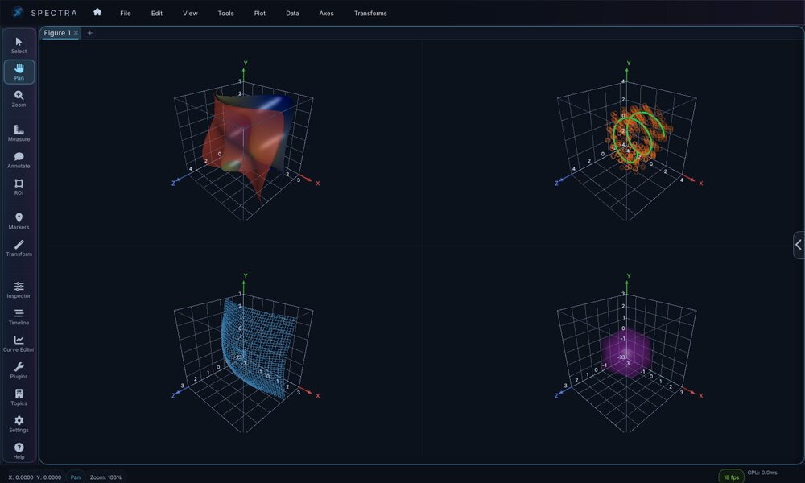

<p align="center">
  
</p>

<h3 align="center">GPU-accelerated scientific plotting for C++20, Python and Rust</h3>

<p align="center">
  <a href="https://github.com/danlil240/Spectra/actions/workflows/ci.yml"></a>
  <a href="https://pypi.org/project/spectra-plot/"></a>
  <a href="https://danlil240.github.io/Spectra/"></a>
  <a href="https://github.com/danlil240/Spectra/blob/main/LICENSE"></a>
</p>

<p align="center">
  <a href="https://danlil240.github.io/Spectra/">Documentation</a> ·
  <a href="https://danlil240.github.io/Spectra/getting-started.html">Getting Started</a> ·
  <a href="https://github.com/danlil240/Spectra/blob/main/examples/README.md">Examples</a> ·
  <a href="https://github.com/danlil240/Spectra/blob/main/python/examples/README.md">Python</a> ·
  <a href="https://github.com/danlil240/Spectra/blob/main/rust/README.md">Rust</a> ·
  <a href="https://github.com/danlil240/Spectra/blob/main/CHANGELOG.md">Changelog</a>
</p>

<p align="center">
  
</p>

<p align="center">
  <code>pip install spectra-plot</code>
</p>

<table>
  <tr>
    <td width="50%"></td>
    <td width="50%"></td>
  </tr>
  <tr>
    <td width="50%"></td>
    <td width="50%"></td>
  </tr>
</table>

> **Status: 0.x public preview.** Spectra is usable today, but the API may change before 1.0.
> Feedback and bug reports are very welcome.

---

## What is Spectra?

Spectra is a plotting library and desktop app that draws everything on the GPU with Vulkan.
Call it from C++, Python or Rust, use it for static figures or live data, and embed it in Qt
apps, Jupyter notebooks or your own tools.

- **GPU rendering** — Vulkan 1.2+. Anti-aliased lines, 17 marker shapes, dash patterns and text
  are drawn on the GPU.
- **Real-time** — stream live data at display rate with cheap appends; NumPy arrays are sent
  without per-element copies.
- **2D and 3D in one library** — lines, scatter, statistics, surfaces and meshes with lighting,
  transparency, colormaps and an orbit camera.
- **MATLAB-style one-liners** — `spectra::plot(x, y, "r--o")` scales up to multi-window,
  multi-tab workspaces.
- **C++, Python and Rust** — a native C++20 library, plus Python and Rust clients that start the
  Spectra backend for you.
- **Headless export** — render PNG, SVG, PDF, GIF or MP4 without a window, for CI and batch jobs.
- **Open your data** — drop a CSV file, a PX4 ULog or an MCAP log on the window and drag fields
  onto plots; save the dashboard as a layout file and reopen it on new data.

## Why Spectra?

There are many good plotting tools. This is how Spectra compares with the ones people ask about
most. The short version: pick Spectra when you want GPU speed, live data and 3D from C++, Python or
Rust. Pick something else when you need a mature ecosystem or a pure-Python install.

| | Spectra | matplotlib | ImPlot | VisPy | pyqtgraph | PlotJuggler |
|---|---|---|---|---|---|---|
| Rendering | GPU (Vulkan) | CPU | GPU (via your ImGui backend) | GPU (OpenGL) | CPU, optional OpenGL | CPU / OpenGL (Qt) |
| Use from | C++20, Python and Rust | Python | C++ (inside Dear ImGui) | Python | Python | Desktop app + plugins |
| Live streaming | Yes | Limited | Yes | Yes | Yes | Yes |
| 3D | Yes (surfaces, meshes, lighting) | Basic (mplot3d) | Separate project (ImPlot3D) | Yes | Yes (OpenGL) | No |
| Ready-made app UI | Yes (inspector, timeline, workspaces) | No | No (you build it) | No | No | Yes |
| ROS2 / PX4 | Built-in adapters (preview) | No | No | No | No | Yes, mature |
| Publication output | PNG, SVG, PDF, GIF, MP4 | Excellent (PDF, SVG, PGF, ...) | Screenshots | PNG | PNG, SVG | Limited |
| Maturity and ecosystem | New (0.x) | Decades, huge | Mature | Mature | Mature | Mature in robotics |
| Install | pip wheel or apt, needs a Vulkan driver | Pure pip | Compile into your app | pip + OpenGL | pip + Qt | apt / snap / AppImage |

Where others are clearly better today: **matplotlib** for publication figures, documentation and
third-party packages; **ImPlot** if you already have a Dear ImGui app; **pyqtgraph** for a
pure-Python Qt stack with no GPU driver requirements; **PlotJuggler** for a battle-tested ROS
log viewer.

### How fast?

Time to redraw one 1600x900 frame of a line plot, rendered offscreen and read back to the CPU so
every library does the same work (median of 30 frames, lower is better). "Stream" replaces the
y data before each redraw, as live data does.

| Points | Spectra | matplotlib | pyqtgraph | Spectra, stream | matplotlib, stream | pyqtgraph, stream |
|---:|---:|---:|---:|---:|---:|---:|
| 10k | **1.3 ms** | 13.2 ms | 7.2 ms | **1.4 ms** | 12.9 ms | 11.0 ms |
| 100k | **1.2 ms** | 23.5 ms | 10.7 ms | **2.4 ms** | 19.6 ms | 14.4 ms |
| 1M | **1.2 ms** | 46.3 ms | 36.6 ms | **10.6 ms** | 46.5 ms | 48.5 ms |
| 10M | **1.2 ms** | 230.2 ms | 219.7 ms | **84.5 ms** | 273.9 ms | 332.8 ms |

Dense lines are reduced to what the screen can show (the first, last, lowest and highest point in
each pixel column), so a redraw costs about the same at 10k and 10M points without losing a
single spike. The stream columns include that pass on every update.

One machine: NVIDIA RTX 5080 (driver 621.40), Ryzen 9 9950X3D, Windows 11, Python 3.12, Spectra
0.4.1, average of two runs; matplotlib on Agg and pyqtgraph on Qt's raster engine. Run it on your
own hardware with [`tools/bench_compare/bench_compare.py`](https://github.com/danlil240/Spectra/blob/main/tools/bench_compare/bench_compare.py);
results from other GPUs are very welcome in an issue.

---

## Quick start

**C++**

```cpp
#include <spectra/easy.hpp>

int main() {
    spectra::plot({0.f, 1.f, 2.f, 3.f, 4.f},
                  {0.f, 1.f, 0.5f, 1.5f, 2.f}, "c-o");
    spectra::title("Hello Spectra");
    spectra::show();
}
```

**Python**

```python
import spectra as sp
sp.plot([0, 1, 4, 9, 16, 25])
sp.show()
```

A slightly bigger Python example with two subplots:

```python
import spectra as sp
import numpy as np

x = np.linspace(0, 10, 500)

sp.subplot(2, 1, 1)
sp.plot(x, np.sin(x), label="sin")
sp.title("Sine")

sp.subplot(2, 1, 2)
sp.plot(x, np.cos(x), label="cos")
sp.title("Cosine")

sp.show()
```

Format strings work like MATLAB and matplotlib: `sp.plot(x, y, "r--o")` (red, dashed,
circle markers), `sp.plot(y, "g^")` (green triangles), or `linestyle=":"` / `marker="s"`.
`sp.plot(df)` draws one line per column of a pandas DataFrame, and `sp.savefig("out.png")` (or
`.svg`, `.pdf`) renders offscreen.

Coming from matplotlib? `import spectra.pyplot as plt` covers the common calls (`plt.subplots`,
`plt.plot`, `plt.errorbar`, `plt.imshow`, `plt.twinx`, `plt.savefig`, ...), so a lot of existing
plotting code runs with only the import changed.

In **Jupyter** the same calls draw inline: each cell's figures appear as PNG images under it,
and `sp.show()` never blocks the kernel. `sp.use_window()` switches to native windows,
`sp.use_inline()` back (or set `SPECTRA_DISPLAY=window|inline`); `spectra.notebook` gives a
live, pannable canvas instead.

Live streaming, 3D plots, statistical charts and the Session API are covered in the
[Feature Guide](https://danlil240.github.io/Spectra/features.html#python-api).

**Rust**

```rust
use spectra_plot::{linspace, Session};

let session = Session::new()?;
let ax = session.figure("Hello")?.subplot(1, 1, 1)?;
let x = linspace(0.0, 10.0, 500);
let y: Vec<f64> = x.iter().map(|v| v.sin()).collect();
ax.plot(&x, &y, "r--")?;
session.show()?;
```

The `spectra-plot` crate is a pure-Rust client for the Spectra backend (no C++ toolchain needed to
build it). Add it with
`cargo add spectra-plot --git https://github.com/danlil240/Spectra --tag v0.4.2`; see
[`rust/README.md`](https://github.com/danlil240/Spectra/blob/main/rust/README.md).

---

## Install

### Supported platforms

| Platform | Status | Notes |
|---|---|---|
| Linux x86_64 — Ubuntu 22.04 / 24.04 / 26.04 | **Supported** | X11 and Wayland. GCC 13+ or Clang 17+ to build from source. |
| macOS (Apple Silicon, via MoltenVK) | Experimental | Builds and runs in CI; expect rough edges. |
| Windows x64 | Experimental | C++ library and app, in-process only (no backend daemon, so no Python package; use WSL2). |
| ROS2, PX4/ULog, Qt embed | Preview | Optional adapters, enabled at build time. |
| WebGPU / WebAssembly | Preview | 2D only. |

Every platform needs a working Vulkan 1.2 driver (Mesa, NVIDIA, AMD, Intel, or MoltenVK on
macOS).

### Python

```bash
pip install spectra-plot
```

No compiler or Vulkan SDK needed — only a Vulkan-capable driver. Linux and macOS only: on
Windows, install it inside WSL2 (its windows open through WSLg).

### APT repository (Ubuntu 22.04 / 24.04 / 26.04)

```bash
# 1. Import the signing key
curl -fsSL https://danlil240.github.io/Spectra/apt/spectra-archive-keyring.asc \
  | sudo gpg --dearmor -o /etc/apt/keyrings/spectra.gpg

# 2. Add the repository (detects your Ubuntu codename)
echo "deb [signed-by=/etc/apt/keyrings/spectra.gpg] https://danlil240.github.io/Spectra/apt $(lsb_release -cs) main" \
  | sudo tee /etc/apt/sources.list.d/spectra.list

# 3. Install
sudo apt update
sudo apt install spectra
```

Each [GitHub release](https://github.com/danlil240/Spectra/releases) also ships `.deb`, `.rpm`,
AppImage, macOS and Windows packages, all GPG-signed.

### Build from source

```bash
sudo apt install build-essential cmake ninja-build git pkg-config \
    libvulkan-dev vulkan-validationlayers mesa-vulkan-drivers \
    glslang-tools \
    libwayland-dev libxrandr-dev libxinerama-dev libxcursor-dev \
    libxi-dev libxkbcommon-dev libgl1-mesa-dev \
    python3 python3-pillow libeigen3-dev

git clone https://github.com/danlil240/Spectra.git
cd Spectra
cmake -B build -G Ninja -DCMAKE_BUILD_TYPE=Release -DSPECTRA_USE_ROS2=OFF
cmake --build build -j$(nproc)
./build/examples/basic_line
```

GLFW, Dear ImGui and FlatBuffers are downloaded automatically by CMake. The full list of
packages and CMake options, including the optional ROS2, PX4, Qt, WebGPU, Eigen and FFmpeg
integrations, is in [`BUILD_ENVIRONMENT.md`](https://github.com/danlil240/Spectra/blob/main/BUILD_ENVIRONMENT.md) and the
[Getting Started guide](https://danlil240.github.io/Spectra/getting-started.html).

To use Spectra from your own CMake project after `cmake --install build`:

```cmake
find_package(spectra REQUIRED)
target_link_libraries(my_app PRIVATE spectra::spectra)
```

---

## Features

| Area | What you get |
|---|---|
| **Core rendering** | Vulkan pipeline, MSAA, GPU text, SDF anti-aliasing, 17 marker shapes, MATLAB-style format strings (`"r--o"`), mathtext (`$\alpha_1$`) in labels |
| **2D plots** | Lines, scatter, step, error bars, bands, second y axis (`twinx`), log and date-time axes, `imshow`, labelled heatmaps, `contour` / `contourf`, colorbars |
| **Statistics** | Histograms, box plots, violins, bars (grouped, stacked, horizontal), stems |
| **3D** | Surface, mesh, scatter and line plots with lighting, transparency, wireframe, colormaps, depth cues, view cube and ortho/perspective camera |
| **Easy API** | `plot()`, `scatter()`, `subplot()`, `plot3()`, `surf()` and friends in one header, `spectra/easy.hpp` |
| **Python** | One-liners, a `spectra.pyplot` module for matplotlib-style code, `savefig()`, pandas DataFrames and Series, NumPy fast path, inline plots and a live canvas in Jupyter |
| **Rust** | The `spectra-plot` crate: the same figures, series, streaming, topics and export as the Python client, in pure Rust |
| **Live data** | Cheap appends, frame callbacks, named topics from any process, UDP JSON/CSV bridge, knobs (sliders your code reads) |
| **Files and layouts** | CSV, PX4 ULog and MCAP (JSON and ROS 2 CDR, no ROS install needed) by drag and drop; layout files that save a dashboard without its data |
| **UI** | Command palette, undo/redo, docking and split views, inspector, data sidebar, configurable shortcuts, style presets, colour-blind palettes |
| **Data interaction** | Tooltips, crosshair, markers, linked axes, shared cursor, compare at x, data transforms |
| **Animation** | Timeline editor, keyframe interpolation, camera animator |
| **Export** | Headless PNG/SVG/PDF/GIF/MP4 with an export dialog (size, DPI, theme), plugin API, CMake `find_package` |
| **Integrations** (preview) | ROS2 app (topic monitor, bag player, TF tree), PX4 app (ULog, live MAVLink), Qt6 widgets and PyQt/PySide, WebGPU (2D) |

> **Full breakdown →** [Feature Guide](https://danlil240.github.io/Spectra/features.html)

---

## Live topics

Any process can publish named data streams ("topics") to Spectra from C++ or Python, before or
after the UI is open; you then drag a topic onto an axes to plot it live. See the
[Topics guide](https://github.com/danlil240/Spectra/blob/main/docs/topics.md), including a Docker publisher-first workflow.

---

## Examples

More than 50 C++ examples, 18 Python scripts and a Jupyter notebook, and 6 Rust examples cover
everything from a basic line plot to lit 3D surfaces, heatmaps, live streams, multi-window tabs
and headless export.

```bash
./build/examples/basic_line
./build/examples/next_level_scientific
./build/examples/lit_surface_demo
```

> **Index →** [C++ examples](https://github.com/danlil240/Spectra/blob/main/examples/README.md) · [Python examples](https://github.com/danlil240/Spectra/blob/main/python/examples/README.md) ·
> [Rust examples](https://github.com/danlil240/Spectra/blob/main/rust/README.md#examples) ·
> [Examples page](https://danlil240.github.io/Spectra/examples.html)

---

## ROS2, PX4, Qt and WebGPU (preview)

Optional integrations, enabled at build time:

- **ROS2** — `spectra-ros`, one native app for live topic plotting, bag playback and recording,
  TF tree and node graph. Build with `-DSPECTRA_USE_ROS2=ON`; see the
  [ROS2 adapter docs](https://danlil240.github.io/Spectra/ros2-adapter.html).
- **PX4** — `spectra-px4` for ULog flight logs and live MAVLink telemetry
  ([PX4 docs](https://danlil240.github.io/Spectra/px4-adapter.html)). The main `spectra` app
  opens ULog and MCAP files too.
- **Qt** — a Spectra canvas inside Qt6 widgets from C++, PyQt or PySide
  ([Qt embedding](https://danlil240.github.io/Spectra/qt-embed.html)).
- **WebGPU** — the same 2D C++ code built for the browser with Emscripten, or natively with
  Dawn. 3D is not ported yet ([WebGPU backend](https://danlil240.github.io/Spectra/webgpu.html)).

---

## How it runs: in-process and multi-process

A Spectra program can run in two ways, and both are always compiled in:

- **In-process** (default) — your program owns the window; plot state, UI and the Vulkan
  renderer live in one process.
- **Multi-process** — a `spectra-backend` daemon owns the session and `spectra-window`
  processes draw the windows, connected over a versioned IPC protocol. The Python package and
  topic publishers use this mode, and start the backend automatically when needed.

At runtime an app uses multi-process mode only when it is given a backend socket (the
`SPECTRA_SOCKET` environment variable or `AppConfig::socket_path`); otherwise it runs
in-process. The CMake option `SPECTRA_RUNTIME_MODE` (`multiproc` by default, or `inproc`) only
decides which binaries are built: `multiproc` also builds `spectra-backend` and
`spectra-window`.

> **Details →** [Architecture overview](https://danlil240.github.io/Spectra/architecture.html)

---

## Quality

- **Nearly 7,000 unit tests** (Google Test), **50+ golden-image tests** rendered headlessly on
  lavapipe, and benchmark suites.
- CI on Linux (GCC and Clang), macOS (Apple Silicon) and Windows (MSVC), plus AddressSanitizer
  and UndefinedBehaviorSanitizer jobs.
- Release pipeline producing `.deb`, `.rpm`, AppImage, macOS and Windows packages and Python
  wheels, all GPG-signed.

```bash
cmake -B build -G Ninja -DSPECTRA_BUILD_TESTS=ON -DSPECTRA_USE_ROS2=OFF
cmake --build build
ctest --test-dir build -LE gpu --output-on-failure
```

---

## Contributing

Contributions are welcome. Please read [CONTRIBUTING.md](https://github.com/danlil240/Spectra/blob/main/CONTRIBUTING.md) for how to build, run
the tests (including GPU tests on lavapipe), format code and write commit messages, and follow the
[Code of Conduct](https://github.com/danlil240/Spectra/blob/main/CODE_OF_CONDUCT.md). Report security issues privately as described in
[SECURITY.md](https://github.com/danlil240/Spectra/blob/main/SECURITY.md).

If you use Spectra in research, see [CITATION.cff](https://github.com/danlil240/Spectra/blob/main/CITATION.cff).

## License

MIT License. See [LICENSE](https://github.com/danlil240/Spectra/blob/main/LICENSE) for details.
