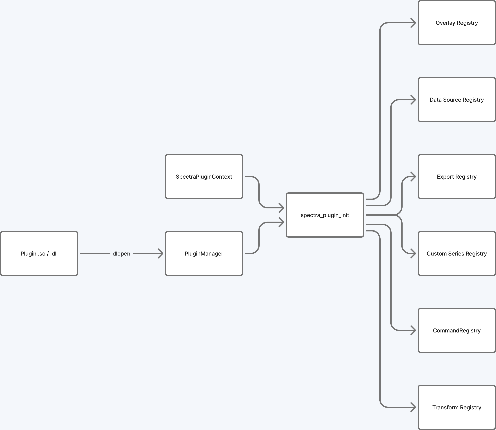

# Spectra Plugin Developer Guide

> **API version covered**: v2.2 (current stable)  
> **Phase D — Custom Series Types** is available in API v2.0 via the `custom_series` registry.

---

## Contents

1. [Overview](#overview)
2. [Plugin structure](#plugin-structure)
3. [Build instructions](#build-instructions)
4. [API version negotiation](#api-version-negotiation)
5. [Extension point types](#extension-point-types)
   - [Commands and shortcuts (v1.0)](#commands-and-shortcuts-v10)
   - [Transform plugins (v1.1)](#transform-plugins-v11)
   - [Overlay plugins (v1.2)](#overlay-plugins-v12)
   - [Export format plugins (v1.3)](#export-format-plugins-v13)
   - [Data source plugins (v1.3)](#data-source-plugins-v13)
6. [ABI rules](#abi-rules)
7. [Lifetime and thread safety](#lifetime-and-thread-safety)
8. [Troubleshooting](#troubleshooting)

---

## Overview



Full-size version: [diagram gallery](diagrams.html)

Spectra plugins are **shared libraries** (`.so` on Linux, `.dylib` on macOS, `.dll` on Windows) that are discovered and loaded at runtime by `PluginManager`. A plugin exports one mandatory symbol, `spectra_plugin_init`, and an optional `spectra_plugin_shutdown`.

The host calls `spectra_plugin_init` once at load time, passing a `SpectraPluginContext` that provides access to all registries. The plugin fills a `SpectraPluginInfo` struct and registers whatever extension points it needs. No framework inheritance or vtable is required.

All plugin-facing APIs use a **C ABI** (`extern "C"`, no STL types, no exceptions). This ensures binary compatibility across compiler versions and toolchains.

---

## Plugin structure

Every plugin must implement exactly this entry point:

```c
// Required entry point; return 0 on success, non-zero to abort load.
int spectra_plugin_init(const SpectraPluginContext* ctx, SpectraPluginInfo* info_out);
```

And may optionally implement:

```c
// Called by the host when the plugin is unloaded.  Free resources here.
void spectra_plugin_shutdown(void);
```

A minimal skeleton:

```cpp
// my_plugin.cpp
#include "ui/workspace/plugin_api.hpp"

using namespace spectra;

extern "C" {

int spectra_plugin_init(const SpectraPluginContext* ctx, SpectraPluginInfo* info)
{
    info->name              = "My Plugin";
    info->version           = "1.0.0";
    info->author            = "Your Name";
    info->description       = "Short description of what this plugin does";
    info->api_version_major = SPECTRA_PLUGIN_API_VERSION_MAJOR;
    info->api_version_minor = SPECTRA_PLUGIN_API_VERSION_MINOR;

    // Register extension points here, gated by spectra_plugin_api_at_least().

    return 0;
}

void spectra_plugin_shutdown()
{
    // Clean up any resources allocated at init time.
}

} // extern "C"
```

The strings in `SpectraPluginInfo` must remain valid for the lifetime of the plugin (use string literals or `static` storage).

---

## Build instructions

Plugins are built as shared libraries with `-fPIC` and linked against the `spectra` static library to get the C ABI registration functions.

### Using the project's CMake helper

The `examples/plugins/CMakeLists.txt` file defines a helper function that sets all required properties:

```cmake
function(add_spectra_plugin name)
    add_library(${name} SHARED ${name}.cpp)
    target_include_directories(${name} PRIVATE
        ${CMAKE_SOURCE_DIR}/src
        ${CMAKE_BINARY_DIR}/generated
    )
    target_compile_features(${name} PRIVATE cxx_std_20)
    target_link_libraries(${name} PRIVATE spectra)
    set_target_properties(${name} PROPERTIES PREFIX "")
endfunction()

add_spectra_plugin(my_plugin)
```

Running `cmake --build build --target my_plugin` produces `my_plugin.so` (no `lib` prefix).

### Building outside the Spectra tree

```cmake
cmake_minimum_required(VERSION 3.20)
project(my_plugin CXX)

find_package(spectra REQUIRED)

add_library(my_plugin SHARED my_plugin.cpp)
set_target_properties(my_plugin PROPERTIES PREFIX "" CXX_STANDARD 20)
target_link_libraries(my_plugin PRIVATE spectra::spectra)
```

Or with a raw compiler command:

```bash
g++ -shared -fPIC -std=c++20 -o my_plugin.so my_plugin.cpp \
    -I/path/to/spectra/src \
    -I/path/to/spectra/build/generated \
    -L/path/to/spectra/build/lib -lspectra
```

### Plugin discovery

Place the built `.so` in one of:
- `~/.config/spectra/plugins/` — scanned automatically on startup
- Any directory passed to `PluginManager::discover()`
- Loaded manually via **View → Plugins → Load Plugin...**

### Plugin manifests (`plugin.json`)

Each plugin may ship an optional `plugin.json` manifest alongside the shared library. The host reads it at load time and uses the `name`, `version`, and `api_version` fields for display and compatibility checks before calling `spectra_plugin_init`.

Manifest format:

```json
{
  "name": "My Plugin",
  "version": "1.0.0",
  "api_version": "2.0",
  "author": "Your Name",
  "description": "Short description",
  "capabilities": ["overlay", "transform"],
  "dependencies": [],
  "min_spectra_version": "0.9.0"
}
```

`capabilities` is informational — it lists the extension point types the plugin registers. Valid values: `"command"`, `"transform"`, `"overlay"`, `"export_format"`, `"data_source"`, `"custom_series"`.

The manifest filename must match the library name: `libmy_plugin.so` → `my_plugin.plugin.json` placed in the same directory (or named `plugin.json` for single-plugin install directories).

---

## API version negotiation

The context struct grows with each version bump. Fields added in later versions are `nullptr` for plugins built against an older version. **Gate registration calls on the `(major, minor)` version pair with `spectra_plugin_api_at_least()`, and null-check the registry** to avoid dereferencing a null registry. Do not test `api_version_minor` on its own: the minor number restarts at 0 on each major bump, so `ctx->api_version_minor >= 1` is false on a v2.0 host even though v2.0 provides every v1.x registry.

```cpp
info->api_version_major = SPECTRA_PLUGIN_API_VERSION_MAJOR;
info->api_version_minor = SPECTRA_PLUGIN_API_VERSION_MINOR;

// v1.1+ required for transform registry
if (spectra_plugin_api_at_least(ctx, 1, 1) && ctx->transform_registry)
    spectra_register_xy_transform(ctx->transform_registry, ...);

// v1.2+ required for overlay registry
if (spectra_plugin_api_at_least(ctx, 1, 2) && ctx->overlay_registry)
    spectra_register_overlay(ctx->overlay_registry, ...);

// v1.3+ required for export format + data source registries
if (spectra_plugin_api_at_least(ctx, 1, 3) && ctx->export_format_registry)
    spectra_register_export_format(ctx->export_format_registry, ...);
```

A v1.0 plugin that requests only commands and shortcuts loads successfully even on a v1.3 host. The host logs a warning if the plugin requests an unsupported minor version.

**Major version increments are breaking.** A v1.x plugin will not load against a v2.x host, and vice versa, unless the host explicitly provides a compatibility shim.

### Version constants

| Constant | Value | Milestone |
|---|---|---|
| `SPECTRA_PLUGIN_API_VERSION_MAJOR` | 2 | Custom series types (`SpectraPluginContext` layout change) |
| `SPECTRA_PLUGIN_API_VERSION_MINOR` | 2 | v2.1: overlay appearance fields (theme, UI scale, font size, text measuring); v2.2: vector (SVG) export of custom series |

v1.1 added the transform registry, v1.2 overlays, v1.3 data sources and export formats;
a v2.x host provides all of them (check with `spectra_plugin_api_at_least()`).

---

## Extension point types

### Commands and shortcuts (v1.0)

Register named commands that appear in the command palette and can be bound to keyboard shortcuts.

```cpp
static void my_command(void* /*user_data*/)
{
    // Runs on the app thread.
}

// In spectra_plugin_init:
SpectraCommandDesc desc{};
desc.id           = "my_plugin.do_thing";  // must be globally unique
desc.label        = "My Plugin: Do Thing";
desc.category     = "My Plugin";
desc.shortcut_hint = "Ctrl+Shift+T";
desc.callback     = my_command;
desc.user_data    = nullptr;

spectra_register_command(ctx->command_registry, &desc);

// Bind a shortcut (optional)
spectra_bind_shortcut(ctx->shortcut_manager, "Ctrl+Shift+T", "my_plugin.do_thing");
```

Push undo/redo actions for reversible operations:

```cpp
spectra_push_undo(ctx->undo_manager,
                  "My Reversible Action",
                  undo_callback, undo_data,
                  redo_callback, redo_data);
```

Unregister at shutdown:

```cpp
void spectra_plugin_shutdown()
{
    // ctx is no longer available here; the host unregisters commands
    // automatically when the plugin is unloaded.
}
```

The host automatically unregisters all commands that were registered by a plugin when that plugin is unloaded.

---

### Transform plugins (v1.1)

Transforms appear in the **Transforms** menu and are applied to series data. Two signatures are supported.

**Scalar transform** — applied independently to each Y value. X is unchanged:

```cpp
// Callback signature: float f(float value, void* user_data)
static float clamp_transform(float value, void* user_data)
{
    float limit = *static_cast<float*>(user_data);
    return value > limit ? limit : (value < -limit ? -limit : value);
}

static float g_limit = 1.0f;

// In spectra_plugin_init (requires API v1.1+):
spectra_register_transform(ctx->transform_registry,
                            "Clamp ±1",
                            clamp_transform,
                            &g_limit,
                            "Clamp Y values to [-1, +1]");
```

**XY transform** — can modify both axes and change the point count (e.g. decimation, interpolation):

```cpp
// Callback signature:
//   void f(x_in, y_in, count, x_out, y_out, out_count, user_data)
//
// x_out / y_out are pre-allocated to at least `count` elements.
// Write the actual output length into *out_count.
static void derivative_xy(const float* x_in, const float* y_in,
                           size_t count,
                           float* x_out, float* y_out, size_t* out_count,
                           void* /*user_data*/)
{
    if (count < 2) { *out_count = 0; return; }

    *out_count = count - 1;
    for (size_t i = 0; i < count - 1; ++i)
    {
        x_out[i] = (x_in[i] + x_in[i + 1]) * 0.5f;
        float dx = x_in[i + 1] - x_in[i];
        y_out[i] = (dx != 0.0f) ? (y_in[i + 1] - y_in[i]) / dx : 0.0f;
    }
}

// In spectra_plugin_init (requires API v1.1+):
spectra_register_xy_transform(ctx->transform_registry,
                               "Derivative",
                               derivative_xy,
                               nullptr,
                               "Numerical derivative dy/dx");
```

See `examples/plugins/transform_smooth.cpp` for a complete moving-average example.

---

### Overlay plugins (v1.2)

Overlays are drawn on top of every axes viewport via `ImDrawList`. The host calls each registered overlay callback after the axes canvas is painted.

```cpp
static void my_overlay(const SpectraOverlayContext* ctx, void* /*user_data*/)
{
    if (!ctx || !ctx->is_hovered)
        return;

    // Draw a diagonal line across the viewport.
    spectra_overlay_draw_line(ctx,
        ctx->viewport_x,              ctx->viewport_y,
        ctx->viewport_x + ctx->viewport_w, ctx->viewport_y + ctx->viewport_h,
        SPECTRA_OVERLAY_COLOR(255, 0, 0, 255),   // opaque red (== 0xFF0000FF)
        1.5f);

    // Print series count in the top-left corner.
    char buf[32];
    snprintf(buf, sizeof(buf), "series: %d", ctx->series_count);
    spectra_overlay_draw_text(ctx,
        ctx->viewport_x + 4.0f, ctx->viewport_y + 4.0f,
        buf,
        SPECTRA_OVERLAY_COLOR(255, 255, 255, 255));  // opaque white
}

// In spectra_plugin_init (requires API v1.2+):
spectra_register_overlay(ctx->overlay_registry, "My Overlay", my_overlay, nullptr);
```

**SpectraOverlayContext fields:**

| Field | Type | Description |
|---|---|---|
| `viewport_x/y` | `float` | Top-left corner of the axes canvas in window coordinates |
| `viewport_w/h` | `float` | Width and height of the axes canvas |
| `mouse_x/y` | `float` | Current mouse position in window coordinates |
| `is_hovered` | `int` (bool) | Non-zero when the mouse is inside the viewport |
| `figure_id` | `uint32_t` | ID of the parent figure |
| `axes_index` | `int` | Index of this axes within the figure |
| `series_count` | `int` | Number of series on this axes |

**Appearance fields (API v2.1+)** — appended to the end of the struct. Read them only when the
host reported v2.1 or newer to `spectra_plugin_init` (`major > 2`, or `major == 2 && minor >= 1`);
older hosts pass a shorter struct.

| Field | Type | Description |
|---|---|---|
| `struct_size` | `uint32_t` | `sizeof(SpectraOverlayContext)` as filled by the host |
| `flags` | `uint32_t` | `SPECTRA_OVERLAY_FLAG_HAS_THEME` when `theme` is valid |
| `ui_scale` | `float` | UI scale factor (1.0 = 100%); multiply thicknesses, radii, gaps |
| `font_size` | `float` | Current UI font height in pixels (already scaled) |
| `theme` | `SpectraOverlayTheme` | Packed host theme colours: `canvas_bg`, `crosshair`, `text`, `text_secondary`, `label_bg`, `label_border`, `accent`, `axis_line`, `grid_major` |
| `measure_text` | function pointer | Measures text in the host UI font (may be `NULL`) |

Use `spectra_overlay_place_label()` to keep a label beside the cursor but inside the viewport.

**Drawing helpers** — do not link ImGui directly; use these host-provided wrappers:

| Function | Description |
|---|---|
| `spectra_overlay_draw_line` | Line between two points |
| `spectra_overlay_draw_rect` | Outlined rectangle |
| `spectra_overlay_draw_rect_filled` | Filled rectangle |
| `spectra_overlay_draw_text` | Text at a position |
| `spectra_overlay_draw_circle` | Outlined circle |
| `spectra_overlay_draw_circle_filled` | Filled circle |

All colors are packed `uint32_t` values with **red in the low byte** (ImGui's `IM_COL32`
layout), so a hex literal reads `0xAABBGGRR`: opaque yellow is `0xFF00FFFF`, and
`0xFFFFFF00` is opaque cyan. Build colours with `SPECTRA_OVERLAY_COLOR(r, g, b, a)` /
`spectra_overlay_pack_rgba()`, and prefer `ctx->theme` colours (v2.1+) so overlays stay
visible on light and dark themes.

Unregister explicitly if needed:

```cpp
spectra_unregister_overlay(ctx->overlay_registry, "My Overlay");
```

The host unregisters all overlays automatically when the plugin is unloaded.

See `examples/plugins/overlay_crosshair.cpp` for a complete crosshair example.

---

### Export format plugins (v1.3)

Register a custom file format that appears in **File → Export As**.

```cpp
static int my_export(const spectra::SpectraExportContext* ctx, void* /*user_data*/)
{
    if (!ctx || !ctx->output_path)
        return 1;

    FILE* f = fopen(ctx->output_path, "wb");
    if (!f) return 1;

    // ctx->figure_json      — JSON description of axes/series/labels/limits
    // ctx->figure_json_len  — byte length of the JSON string
    // ctx->rgba_pixels      — raw RGBA buffer (may be NULL if not rendered)
    // ctx->pixel_width/height

    // ... write to file ...

    fclose(f);
    return 0;   // 0 = success
}

// In spectra_plugin_init (requires API v1.3+):
spectra_register_export_format(ctx->export_format_registry,
                                "My Format",     // display name
                                "myfmt",         // file extension (no dot)
                                my_export,
                                nullptr);
```

**SpectraExportContext fields:**

| Field | Type | Description |
|---|---|---|
| `figure_json` | `const char*` | JSON string describing the figure |
| `figure_json_len` | `size_t` | Byte length of `figure_json` |
| `rgba_pixels` | `const uint8_t*` | Raw RGBA pixel buffer, or `NULL` |
| `pixel_width/height` | `uint32_t` | Pixel buffer dimensions |
| `output_path` | `const char*` | Destination file path |

Unregister:

```cpp
spectra_unregister_export_format(ctx->export_format_registry, "My Format");
```

See `examples/plugins/export_csv.cpp` for a complete CSV export example.

---

### Data source plugins (v1.3)

Data sources supply streaming data to Spectra's live series. Registered sources appear in the **Data Sources** panel, where the user can start and stop them. The host calls `poll_fn` once per frame to collect new data points.

```cpp
struct MySourceState
{
    bool running = false;
    double t    = 0.0;
};

static MySourceState g_state;

static void   source_start(void* ud)      { static_cast<MySourceState*>(ud)->running = true; }
static void   source_stop(void* ud)       { static_cast<MySourceState*>(ud)->running = false; }
static int    source_running(void* ud)    { return static_cast<MySourceState*>(ud)->running ? 1 : 0; }

static size_t source_poll(spectra::SpectraDataPoint* out, size_t max, void* ud)
{
    auto* s = static_cast<MySourceState*>(ud);
    if (!s->running || max == 0) return 0;

    s->t += 0.016;  // assume ~60 Hz
    out[0].series_label = "sine";
    out[0].timestamp    = s->t;
    out[0].value        = static_cast<float>(sin(s->t));
    return 1;
}

static void source_ui(void* ud)
{
    // Optional: draw ImGui controls in the Data Sources panel.
    // Do NOT call spectra_overlay_draw_* here — this is a UI callback, not an overlay.
}

// In spectra_plugin_init (requires API v1.3+):
spectra::SpectraDataSourceDesc desc{};
desc.name         = "Sine Generator";
desc.start_fn     = source_start;
desc.stop_fn      = source_stop;
desc.is_running_fn = source_running;
desc.poll_fn      = source_poll;
desc.build_ui_fn  = source_ui;   // optional; set to NULL if not needed
desc.user_data    = &g_state;

spectra_register_data_source(ctx->data_source_registry, &desc);
```

**SpectraDataPoint fields:**

| Field | Type | Description |
|---|---|---|
| `series_label` | `const char*` | Target series name (must remain valid until after poll returns) |
| `timestamp` | `double` | Seconds; epoch is source-defined |
| `value` | `float` | Scalar value for this data point |

**SpectraDataSourceDesc fields:**

| Field | Required | Description |
|---|---|---|
| `name` | Yes | Human-readable source name |
| `name_fn` | No | Dynamic name callback; overrides `name` if non-null |
| `start_fn` | Yes | Called when user starts the source |
| `stop_fn` | Yes | Called when user stops the source |
| `is_running_fn` | Yes | Returns non-zero when running |
| `poll_fn` | Yes | Returns new data points (called once per frame) |
| `build_ui_fn` | No | Optional ImGui panel; set to `NULL` to skip |
| `user_data` | — | Passed to all callbacks |

Unregister:

```cpp
spectra_unregister_data_source(ctx->data_source_registry, "Sine Generator");
```

---

## Phase D: Custom Series Types (deferred)

Custom series type registration requires **API v2.0** and depends on renderer decoupling work (QW-2/QW-3/QW-4 from `ARCHITECTURE_REVIEW.md`). The design document is at `docs/plans/CUSTOM_SERIES_DESIGN.md`. This section will be expanded when Phase D lands. A major version bump (`SPECTRA_PLUGIN_API_VERSION_MAJOR` → 2) will accompany the breaking `SpectraPluginContext` layout change.

### Vector (SVG) export of custom series (v2.2)

SVG exports do not run GPU pipelines, so a custom series type only appears in them when it
registers a CPU export callback after `spectra_register_series_type()`:

```cpp
static int my_export(const void* data, size_t count, const SpectraVectorSink* sink, void*)
{
    const float rgba[4] = {1.0f, 0.0f, 0.0f, sink->opacity};
    sink->fill_rect(sink->host, 0.0f, 0.0f, 1.0f, 1.0f, rgba);   // data coordinates
    return 0;                                                     // non-zero: series dropped
}

if (spectra_plugin_api_at_least(ctx, 2, 2))
    spectra_register_series_vector_export(ctx->series_type_registry, "my_type", my_export, nullptr);
```

The sink offers `fill_polygon`, `stroke_polyline` and `fill_rect`; coordinates are data space
(the host adds the series offset and applies the axes limits and log scales), colours straight
RGBA in [0, 1]. `series_color` is the series colour as drawn and `opacity` the series opacity.
Series whose type has no callback (or whose plugin is disabled) are replaced by an XML comment
and a logged warning. 2D axes only. See `examples/plugins/series_heatmap.cpp`.

---

## ABI rules

### What can cross the plugin boundary

| Allowed | Notes |
|---|---|
| Plain C types (`int`, `float`, `double`, `size_t`, `uint32_t`, …) | Safe across ABI |
| `const char*` (null-terminated) | Lifetime: see below |
| `void*` opaque handles | Dereferenced only by the host |
| Structs composed entirely of the above | No virtual functions, no STL members |
| Function pointers matching the declared typedef | Must use C calling convention |

### What must NOT cross the plugin boundary

| Forbidden | Reason |
|---|---|
| `std::string`, `std::vector`, any STL container | ABI varies by compiler/stdlib |
| C++ exceptions | Exception tables are ABI-specific |
| `new`/`delete` from the host heap | Heap ownership mismatch across module boundaries |
| ImGui types (`ImDrawList*`, `ImVec2`, …) | Not stable; use `spectra_overlay_draw_*` helpers |
| Vulkan handles (`VkDevice`, `VkQueue`, …) | Not exposed in v1.x; reserved for v2.x custom series |
| References to temporaries | Pointer must outlive the call |

---

## Lifetime and thread safety

### String lifetimes

Strings passed **into** a registration function (names, descriptions, command IDs) must remain valid for the lifetime of the plugin. Use string literals (`"My Name"`) or static storage. Do not pass stack-allocated buffers.

Strings passed **out** of a poll callback (`SpectraDataPoint::series_label`) must remain valid until the callback returns. After `poll_fn` returns the host has consumed the value.

### Callback thread

All callbacks are called from the **app thread** (the same thread that runs the ImGui frame loop). Callbacks must not:
- Block for extended periods
- Spawn threads that call back into the host
- Acquire locks held by the host (deadlock risk)

If a plugin needs to produce data from a background thread, protect shared state with its own mutex and copy data out in `poll_fn`.

### Registry access

All host registries are internally mutex-protected. It is safe to call `spectra_register_*` / `spectra_unregister_*` from any thread, but in practice plugins are loaded on the app thread and there is no need to do cross-thread registration.

### Overlay draw callbacks

Overlay callbacks are called inside an active `ImDrawList` scope. No allocations are permitted inside the callback. Pre-allocate all buffers (e.g. for label strings) as static or member storage.

---

## Troubleshooting

### Plugin fails to load

- Check that `spectra_plugin_init` is exported with C linkage (`extern "C"`). Symbol mangling is the most common cause of load failure.
- Verify the shared library was built with the same `SPECTRA_PLUGIN_API_VERSION_MAJOR` as the host. A major mismatch causes an immediate load rejection with a logged error.
- Ensure all transitive dependencies of the plugin `.so` are on `LD_LIBRARY_PATH` (Linux) or `DYLD_LIBRARY_PATH` (macOS).

### Registration call is silently ignored

- Check that you are gating the call with `spectra_plugin_api_at_least(ctx, major, minor)` rather than `api_version_minor` alone. If the guard condition is false the registration is skipped without error.
- Verify the registry pointer in the context is non-null before calling the register function.

### Commands registered by the plugin are not in the palette

- Confirm the `id` field in `SpectraCommandDesc` is unique. Duplicate IDs are silently rejected.
- The `category` field must be non-null; use `""` for no category rather than `NULL`.

### Overlay is not rendered

- Ensure the callback is not returning early due to `!ctx->is_hovered` when you expect it to draw unconditionally.
- Drawing functions outside a valid `SpectraOverlayContext` are no-ops. Do not cache the context pointer across frames.

### Transform does not appear in the menu

- The `name` passed to `spectra_register_transform` must be unique within the registry. Re-registration of an existing name is silently ignored.
- Transforms registered after the figure window is opened may require a menu rebuild. Reload the plugin if you do not see the transform listed.

### API version mismatch warning in the log

```
[PluginManager] warning: plugin "Foo" requests api_version_minor=5 but host supports 3
```

The plugin will load, but fields added in minor versions 4+ will be `nullptr` in the context. The plugin must handle this gracefully with version guards.

### Debug logging

Set the environment variable `SPECTRA_PLUGIN_LOG=1` before running Spectra to enable verbose plugin load/unload messages in the console output.
